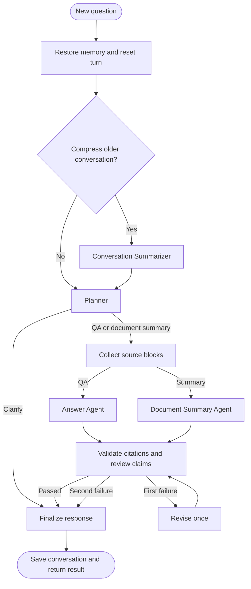

# PDF Insight Agent

Ask questions about a PDF, summarize its contents, and inspect highlighted source
blocks beside the conversation. A LangGraph workflow separates planning, answering,
summarization and review, while SQLite preserves conversation memory across restarts.

## Features

- PDF question answering with source citations and page navigation
- Document Summary Agent with batched processing for longer documents
- Conversation Summarizer that compresses older messages and preserves recent turns
- Persistent, document-scoped conversation memory and a New Chat action
- Live workflow progress and expandable execution records
- Validated model output, citation checks and one bounded answer revision
- Content-based document caching and coordinate-based source highlighting
- Gemini and OpenAI-compatible Gemma endpoint support

## Workflow



The model chooses source IDs; the backend supplies their text and coordinates.
Conversation memory helps interpret follow-up questions. PDF claims still require
original document evidence. The interface shows workflow activity and validation
outcomes rather than private model reasoning.

See [Agent Logic and Learning Guide](docs/AGENT_LOGIC.md) for node contracts,
memory lifecycle, source handling and extension instructions. The generated
[LangGraph topology](docs/workflow.mmd) mirrors the compiled workflow.

## Stack

- React, Vite and React-PDF
- FastAPI and PyMuPDF
- LangGraph with async SQLite checkpoints
- LangChain Gemini integration or an HTTP Gemma adapter

## Run Locally

Use Python 3.11+ and a Node.js version compatible with Vite 8 (20.19+ or 22.12+).

### Backend

```bash
cd backend
python3 -m venv venv
source venv/bin/activate
pip install -r requirements.txt
cp .env.example .env
```

Edit `.env` and supply your Gemini API key:

```dotenv
LLM_PROVIDER=gemini
GEMINI_API_KEY=your_api_key
GEMINI_MODEL=gemini-2.5-flash
```

For Gemma, set `LLM_PROVIDER=gemma`, `GEMMA_API_URL`, `GEMMA_API_KEY` and
`GEMMA_MODEL`. The endpoint must support chat messages and JSON output.

```bash
uvicorn main:app --reload
```

The API runs at `http://localhost:8000`; API documentation is at
`http://localhost:8000/docs`.

### Frontend

In a second terminal:

```bash
cd frontend
npm install
npm run dev
```

Open the URL printed by Vite, normally `http://localhost:5173`.
For a different backend, configure `VITE_API_BASE_URL` in `frontend/.env.local`.
Update backend `CORS_ORIGINS` if the frontend origin changes.

Upload a PDF, ask a question, or select **摘要文件** to create a document summary.
Source buttons jump to highlighted blocks. **新聊天** starts fresh conversation memory.
Existing uploads from the earlier prototype should be uploaded again to build the
new content-addressed cache and source coordinates.

## Configuration

| Variable | Default | Purpose |
| --- | --- | --- |
| `LLM_TIMEOUT_SECONDS` | `90` | Timeout per provider request |
| `MEMORY_SUMMARY_TRIGGER_CHARS` | `16000` | Conversation compression threshold |
| `MEMORY_KEEP_TURNS` | `4` | Recent complete turns retained alongside the new question |
| `MAX_SUMMARY_CHARS` | `200000` | Full-document summary input limit |
| `CORS_ORIGINS` | localhost and 127.0.0.1 on port 5173 | Allowed frontend origins |

Summaries trigger only when enough older messages are available to compress.
Conversation summaries are bounded; the threshold is character-based, not an exact
token count. Uploads are limited to 25 MB. Long-document QA uses a local lexical
retriever with a 24,000-character source budget. Full-document summaries process
all source blocks in batches or explicitly report that the size limit was exceeded.

## Project Layout

```text
backend/
  agent/state.py                 State and validated model contracts
  agent/graph.py                 Nodes, routing, review and summarization
  agent/retrieval.py             Local retrieval and summary batching
  services/document_service.py  Content-addressed storage
  services/pdf_service.py       Text and source coordinates
  services/llm_service.py       Async provider adapter
  main.py                      Upload, chat, stream and history APIs
  tests/test_workflow.py        Offline regression tests
frontend/src/
  components/ChatBox.jsx        Conversation, memory and progress UI
  components/PdfViewer.jsx      Source overlays and navigation
  stream.js                    Incremental SSE parser
```

Runtime PDFs and checkpoints are stored under `backend/data/` and excluded from Git.
API keys and local environments are also excluded. The current-document shortcut
is global to this local installation; actual chat requests explicitly identify both
the document and conversation.

## API

- `POST /api/upload`: upload a PDF; returns its document ID and relative file URL
- `GET /api/current-file`: most recently selected document
- `GET /api/documents/{document_id}/file`: read a stored PDF
- `POST /api/chat`: execute the workflow and return JSON
- `POST /api/chat/stream`: execute the same workflow with SSE events
- `GET /api/threads/{thread_id}?document_id=...`: restore recent conversation

Both chat endpoints require `question`, a SHA-256 `document_id` and a UUID
`thread_id`. Streaming events are `status`, `result` or `error`. Only the final
verified response is shown as an answer; failed verification returns an explicit
unverified response without highlights.

## Checks

From `backend`:

```bash
venv/bin/python -m unittest discover -s tests -v
```

From `frontend`:

```bash
npm test
npm run lint
npm run build
```

Tests use a fake model and exercise the actual workflow, PDF extraction, SQLite
persistence, citation rejection and SSE parsing without sending documents to a
model provider. They do not establish live model accuracy.

For interactive API debugging, start the backend, upload a PDF in the browser,
and run `python debug_chat.py` from `backend`.

## Limitations

- This is a local prototype without authentication or per-user ownership checks.
  Run a single API worker; production concurrency requires shared coordination.
- Source highlights cover extracted blocks rather than exact answer sentences.
- Scanned PDFs need OCR; complex tables and multi-column layouts may need better parsing.
- Lexical retrieval may miss semantic matches; it is not embedding-based retrieval.
- Model review reduces unsupported answers but cannot guarantee factual correctness.
- Memory is scoped to a chat and document; cross-chat profile memory is not implemented.
- Older checkpoints remain on disk after conversation compression. Retention and
  deletion controls are not implemented.
- Execution records are kept in the current UI session; reload restores recent
  conversation, summary presence and the latest source selection.
